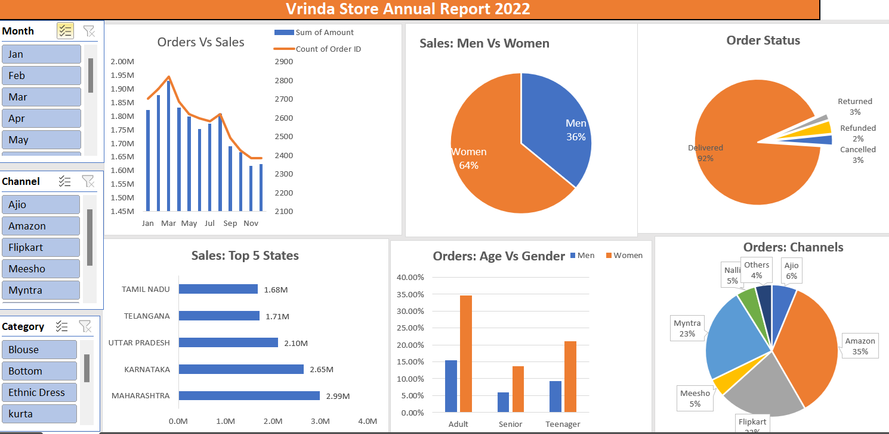

# Store-Annual-Sales-Analysis-Dashboard-Excel
Interactive Excel dashboard for analyzing retail sales, customer demographics, order status, state-wise performance, and sales channels using PivotTables, PivotCharts, and Slicers.
#  Store Annual Sales Analysis Dashboard

## Project Overview

This project analyzes Vrinda Store's 2022 retail sales data using Microsoft Excel. An interactive dashboard was developed to explore sales trends, customer demographics, order status, state-wise performance, and sales channels.

## Tools Used

* Microsoft Excel
* PivotTables
* PivotCharts
* Slicers
* Data Analysis and Visualization

## Dashboard Features

### 1. Orders vs Sales

Analyzes monthly sales amounts and order counts to identify trends.

### 2. Sales: Men vs Women

Compares sales contributions from male and female customers.

### 3. Order Status

Visualizes delivered, cancelled, refunded, and returned orders.

### 4. Sales by State

Highlights the top five states by sales amount.

### 5. Orders: Age vs Gender

Compares order distribution across age groups and genders.

### 6. Orders by Channel

Analyzes order contributions across Amazon, Myntra, Flipkart, Ajio, Meesho, Nalli, and other channels.

### 7. Interactive Dashboard

Uses Month, Channel, and Category slicers to filter the data.

## Key Learnings

* Analyzing retail sales data using Excel.
* Creating PivotTables and PivotCharts.
* Building interactive dashboards using slicers.
* Identifying sales trends and customer patterns.
* Presenting business insights through data visualization.

## Files Included

* `Store Annual Report.xlsx` — Excel workbook containing the sales analysis and dashboard.
* `dashboard.png` — Screenshot of the dashboard.

## Conclusion

This project demonstrates the use of Microsoft Excel for retail sales analysis and interactive dashboard development. It helps explore sales performance, customer segments, order status, and sales channel contributions.

## Dashboard Preview

